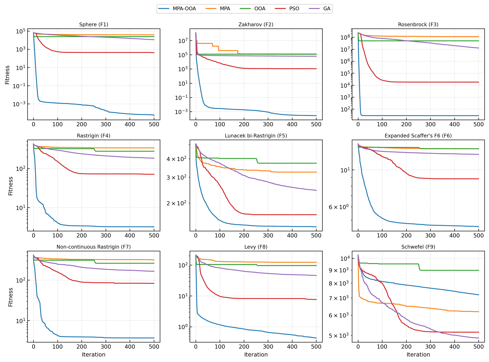
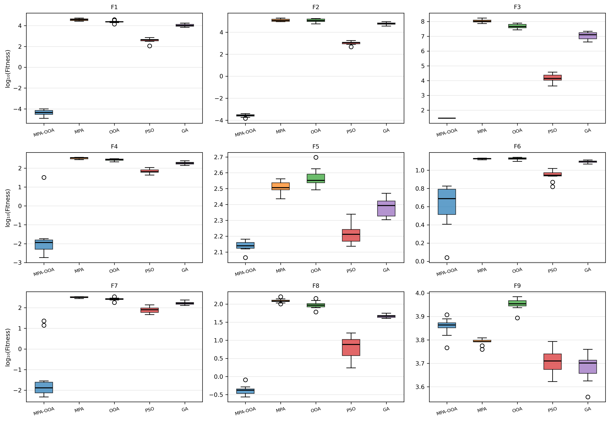
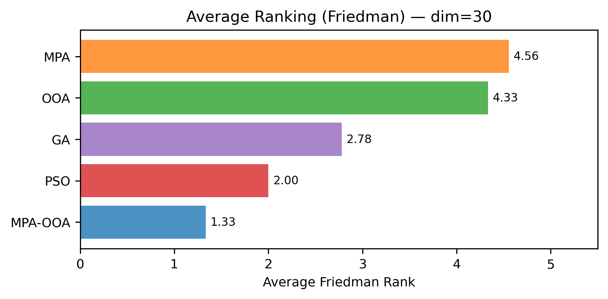
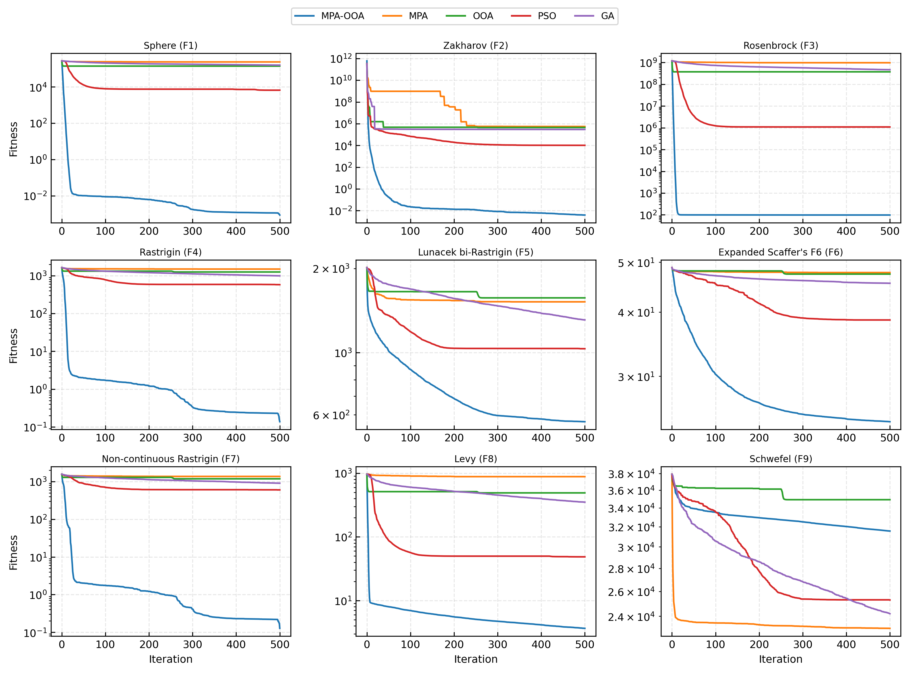
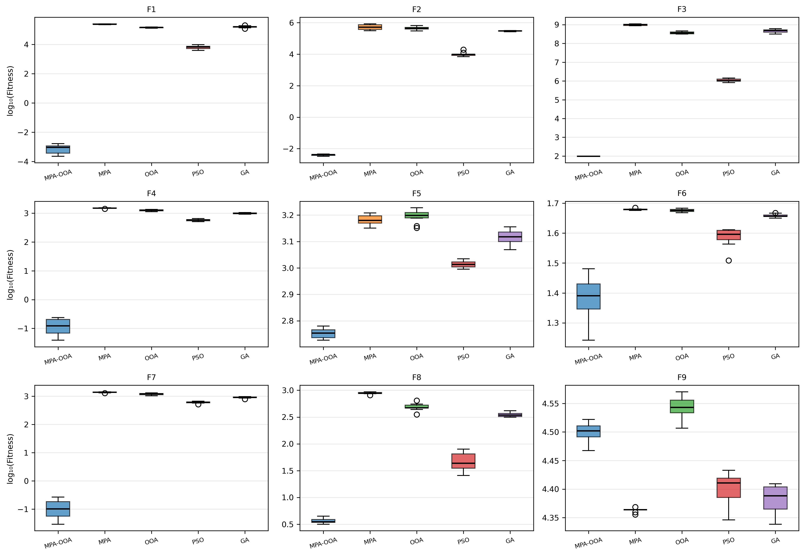
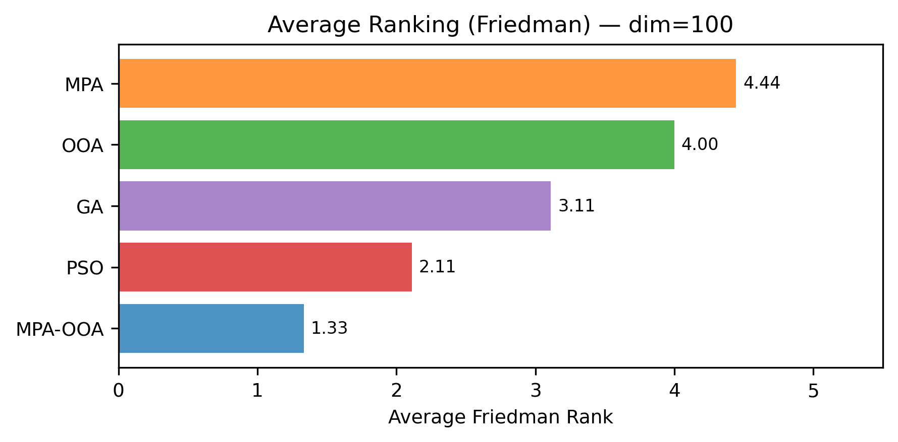
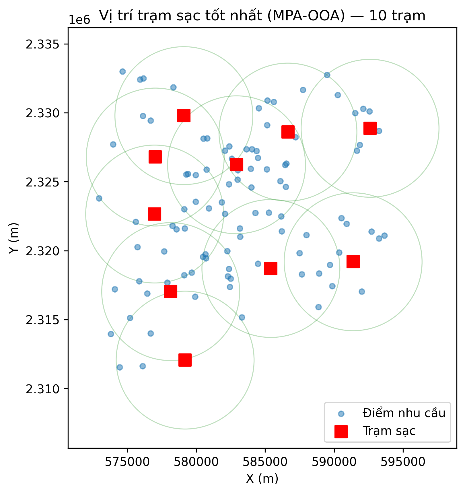
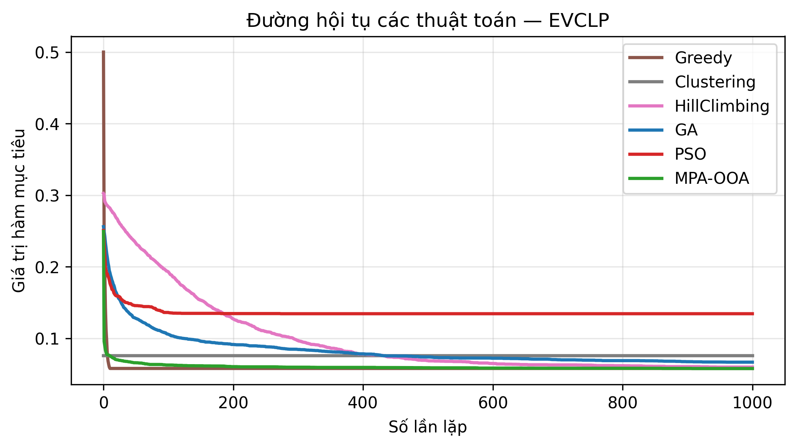
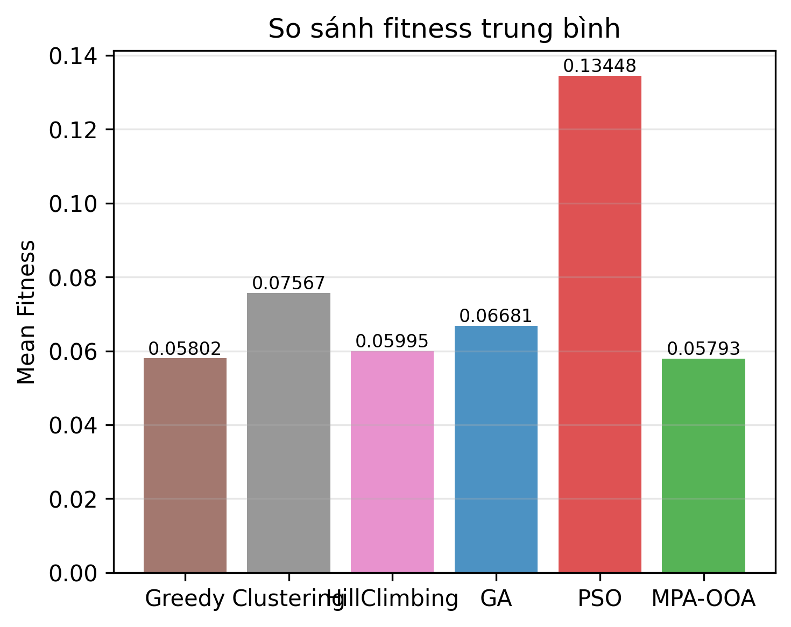
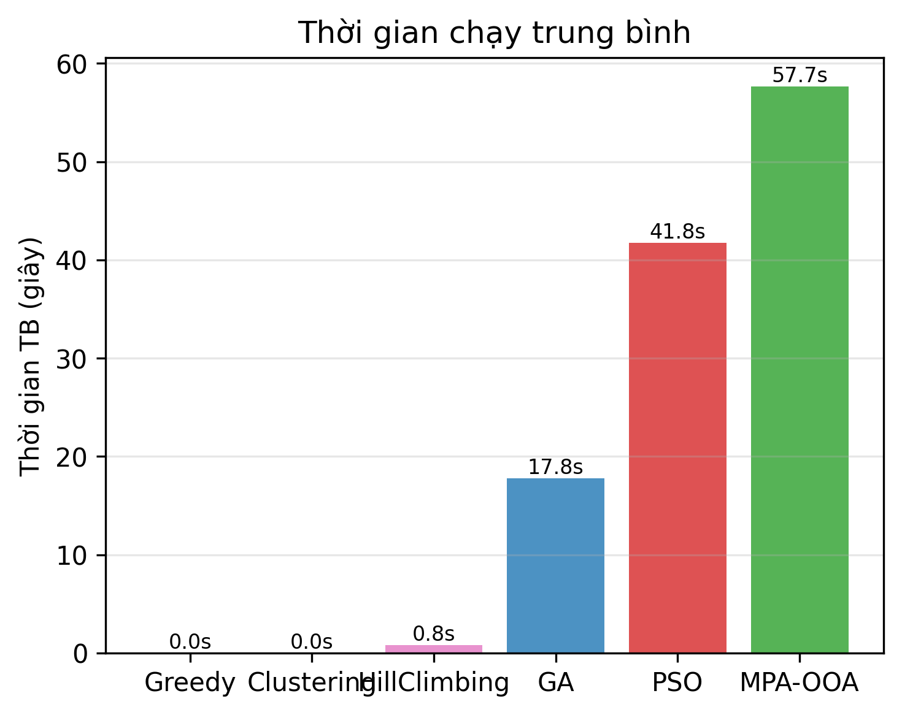

<div align="center">

# MPA-OOA

### Thuật toán lai Marine Predators – Osprey Optimization cho bài toán đặt trạm sạc xe điện


[Giới thiệu](#giới-thiệu) •
[Cài đặt](#cài-đặt) •
[Sử dụng](#sử-dụng) •
[Kết quả](#kết-quả) •
[Cấu trúc thư mục](#cấu-trúc-thư-mục)

</div>

---

## Giới thiệu

Kho mã này chứa mã nguồn và kết quả thực nghiệm của **MPA-OOA**, thuật toán metaheuristic lai giữa
**Marine Predators Algorithm (MPA)** và **Osprey Optimization Algorithm (OOA)**. Thực nghiệm gồm hai phần:

| Phần | Mô tả |
|---|---|
| **Benchmark CEC2017** | Đánh giá trên 9 hàm thử CEC2017 ở số chiều D = 30 và D = 100, so sánh với MPA, OOA, PSO, GA |
| **EVCLP Hà Nội** | Bài toán đặt trạm sạc xe điện (EV Charging Location Problem) khu vực Vành đai 1, Hà Nội, dữ liệu thực từ OpenStreetMap |

### Các cơ chế cải tiến

| Cơ chế | Vai trò |
|---|---|
| **Lévy flight + chaos map** | Bước nhảy khám phá không gian tìm kiếm, điều biến bằng logistic map |
| **Opposition-Based Learning (OBL)** | Sinh nghiệm đối lập, tăng đa dạng quần thể |
| **Dynamic FADs** | Xác suất nhiễu loạn thích ứng theo hệ số khám phá `E_f` |
| **Elite pool** | Duy trì tập cá thể ưu tú để dẫn dắt quá trình tìm kiếm |

Chuyển pha khám phá ↔ khai thác dựa trên hệ số `E_f`, tổng hợp từ tiến trình vòng lặp, mức độ trì trệ
và độ đa dạng quần thể. Khi phát hiện trì trệ quá 20 vòng liên tiếp, một phần quần thể được tái khởi tạo.
Mỗi cơ chế có thể bật/tắt độc lập phục vụ ablation study.

---

## Cài đặt

Yêu cầu **Python ≥ 3.9** (đã kiểm thử trên Python 3.12).

```bash
git clone https://github.com/hnguyeennn/MPA-OOA-EV-Charging.git
cd MPA-OOA-EV-Charging

python -m venv .venv
# Windows
.venv\Scripts\activate
# Linux / macOS
source .venv/bin/activate

pip install -r requirements.txt
```

> `scikit-posthocs` là tùy chọn, chỉ dùng cho kiểm định Nemenyi trong phần benchmark.

---

## Sử dụng

Các script tự xác định đường dẫn `data/` và `results/` theo vị trí file, có thể chạy từ thư mục gốc.

**Benchmark CEC2017**

```bash
python benchmark_cec2017/src/mpa_ooa_benchmark.py
```

**EVCLP Hà Nội**

```bash
python evclp_hanoi/src/mpa_ooa_evclp.py          # Thực nghiệm chính: 6 thuật toán + ablation
python evclp_hanoi/src/decode_best_solution.py   # Giải mã nghiệm tốt nhất (chạy sau bước trên)
python evclp_hanoi/src/ablation_wilcoxon.py      # Ablation kèm kiểm định Wilcoxon
python evclp_hanoi/src/sensitivity_budget.py     # Phân tích độ nhạy theo ngân sách
python evclp_hanoi/src/seeded_mpa_ooa.py         # Khởi tạo MPA-OOA từ nghiệm Greedy
python evclp_hanoi/src/heuristics_only.py        # (Tùy chọn) chỉ chạy 3 heuristic
```

Kết quả (CSV, PNG) được ghi vào thư mục `results/` tương ứng.

---

## Kết quả

### 1. Benchmark CEC2017

**Thiết lập:** 9 hàm (Sphere, Zakharov, Rosenbrock, Rastrigin, Lunacek bi-Rastrigin, Expanded Schaffer's F6,
Non-continuous Rastrigin, Levy, Schwefel) · quần thể 50 · 500 vòng lặp · 10 lần chạy độc lập.

**Xếp hạng Friedman trung bình** (thấp hơn là tốt hơn):

| D | **MPA-OOA** | PSO | GA | OOA | MPA | Friedman *p* |
|:---:|:---:|:---:|:---:|:---:|:---:|:---:|
| 30  | **1.33** | 2.00 | 2.78 | 4.33 | 4.56 | 8.2 × 10⁻⁶ |
| 100 | **1.33** | 2.11 | 3.11 | 4.00 | 4.44 | 8.0 × 10⁻⁵ |

<p align="center">
  
  <br><em>Đường hội tụ trên 9 hàm CEC2017 (D = 30)</em>
</p>

<details>
<summary><b>Xem thêm biểu đồ (boxplot, xếp hạng, D = 100)</b></summary>
<br>
<p align="center">
  <br>
  <br>
  <br>
  <br>
  
</p>
</details>

### 2. EVCLP Vành đai 1 Hà Nội

#### Mô tả bài toán

- **Khu vực:** Vành đai 1, Hà Nội (lat 20.9–21.1, lon 105.7–105.9), hệ tọa độ UTM Zone 48N (EPSG:32648).
- **Dữ liệu:** 200 vị trí ứng viên (trạm xăng, bãi đỗ xe, trạm sạc hiện có) và 100 điểm nhu cầu,
  trích xuất từ OpenStreetMap qua Overpass API.
- **Hàm mục tiêu:** tổng có trọng số của 4 thành phần, có phạt vi phạm ràng buộc:

$$
F = 0.3\,C_{cost} + 0.3\,C_{cov} + 0.2\,C_{acc} + 0.2\,C_{grid}
$$

| Thành phần | Ý nghĩa |
|---|---|
| $C_{cost}$ | Chi phí xây dựng và vận hành so với ngân sách (mặc định 100 tỷ VNĐ) |
| $C_{cov}$ | Tỉ lệ điểm nhu cầu không được phủ trong bán kính 5 km |
| $C_{acc}$ | Khả năng tiếp cận, khoảng cách có trọng số theo nhu cầu |
| $C_{grid}$ | Mức vượt tải công suất lưới điện tại trạm |

#### Thuật toán so sánh

| Nhóm | Thuật toán | Thiết lập |
|---|---|---|
| Metaheuristic | **MPA-OOA** | quần thể 70, 1000 vòng lặp |
| | PSO | quần thể 50, 1000 vòng lặp |
| | GA | quần thể 20, 1000 vòng lặp |
| Heuristic | Greedy | Chọn vị trí có tỷ số (nhu cầu mới được phủ / chi phí) lớn nhất cho đến khi hết ngân sách |
| | Clustering | K-means trên điểm nhu cầu, chọn ứng viên gần tâm cụm nhất |
| | Hill Climbing | Leo đồi bit-flip ngẫu nhiên, chấp nhận khi cải thiện |

#### Kết quả chính (10 lần chạy độc lập)

| Thuật toán | Fitness TB | Std | Best | Thời gian TB | *p*-value |
|---|:---:|:---:|:---:|:---:|:---:|
| PSO | 0.13448 | 0.00910 | 0.11773 | 41.8 s | 0.00195 ** |
| Clustering | 0.07567 | 0.00434 | 0.07181 | < 0.01 s | 0.00195 ** |
| GA | 0.06681 | 0.00459 | 0.05959 | 17.8 s | 0.00195 ** |
| Hill Climbing | 0.05995 | 0.00190 | 0.05718 | 0.8 s | 0.0488 * |
| Greedy | 0.05802 | — | 0.05802 | < 0.1 s | 0.846 |
| **MPA-OOA** | **0.05793** | 0.00100 | **0.05652** | 57.7 s | — |

<sub>Kiểm định Wilcoxon signed-rank so với MPA-OOA. ** *p* < 0.01 · * *p* < 0.05. Greedy là thuật toán tất định.</sub>

**Nghiệm tốt nhất:**

| Thuật toán | Số trạm | Độ phủ | Khoảng cách TB đến trạm gần nhất |
|---|:---:|:---:|:---:|
| Clustering | 6 | 91.0% | 2 883 m |
| PSO | 34 | 97.0% | 2 063 m |
| GA | 11 | 98.0% | 2 592 m |
| Hill Climbing | 11 | 98.0% | 2 740 m |
| Greedy | 10 | 98.0% | 2 976 m |
| **MPA-OOA** | **10** | **98.0%** | **2 562 m** |

MPA-OOA đạt fitness tốt nhất, vượt trội có ý nghĩa thống kê so với PSO, Clustering, GA và Hill Climbing.
So với Greedy ở ngân sách 100 tỷ VNĐ, fitness tương đương (chênh 0.1%, *p* = 0.846); với cùng số trạm
và độ phủ, khoảng cách trung bình của MPA-OOA ngắn hơn 13.9%.

<p align="center">
  
  <br><em>Vị trí trạm sạc trong nghiệm tốt nhất của MPA-OOA</em>
</p>

<details>
<summary><b>Xem thêm biểu đồ (hội tụ, fitness, thời gian chạy)</b></summary>
<br>
<p align="center">
  <br>
  <br>
  
</p>
</details>

#### Độ nhạy theo ngân sách

| Ngân sách | Greedy | MPA-OOA | Cải thiện | *p*-value |
|---|:---:|:---:|:---:|:---:|
| 100 tỷ VNĐ | 0.05802 | 0.05793 | 0.1% | 0.846 |
| 10 tỷ VNĐ | 0.24585 | **0.18193** | **26.0%** | 0.00195 ** |

Khi ngân sách bị siết chặt, xung đột giữa các mục tiêu tăng lên và MPA-OOA vượt trội có ý nghĩa thống kê
so với cả 5 thuật toán đối chứng.

#### Khởi tạo từ nghiệm Greedy

| Biến thể | Fitness TB | Std | *p*-value | Thời gian TB |
|---|:---:|:---:|:---:|:---:|
| MPA-OOA (khởi tạo ngẫu nhiên) | 0.05793 | 0.00100 | — | 66.1 s |
| MPA-OOA (khởi tạo từ Greedy) | **0.05701** | 0.00069 | 0.0488 * | 67.9 s |

Đưa nghiệm Greedy vào quần thể ban đầu cải thiện chất lượng nghiệm có ý nghĩa thống kê; thời gian chạy
không đổi đáng kể do số vòng lặp cố định.

### 3. Ablation study

Lần lượt loại bỏ từng cơ chế và so sánh với phiên bản đầy đủ.

| Cấu hình (EVCLP) | Δ Fitness so với bản đầy đủ | *p*-value |
|---|:---:|:---:|
| w/o Lévy Chaos | −1.74% | 0.232 |
| w/o OBL | −0.89% | 0.275 |
| w/o Dynamic FADs | −0.06% | 0.846 |
| w/o Elite Pool | +0.01% | 1.000 |

Trên EVCLP, không cơ chế đơn lẻ nào tạo khác biệt có ý nghĩa thống kê. Hiệu quả của MPA-OOA đến từ sự
phối hợp giữa các cơ chế. Kết quả ablation trên CEC2017 xem tại `benchmark_cec2017/results/ablation_dim*.{csv,png}`.

---

## Cấu trúc thư mục

```
.
├── benchmark_cec2017/
│   ├── src/
│   │   └── mpa_ooa_benchmark.py          # MPA-OOA, MPA, OOA, PSO, GA trên CEC2017
│   └── results/
│       ├── benchmark_stats_dim{30,100}.csv   # Thống kê + Wilcoxon
│       ├── friedman_dim{30,100}.csv          # Xếp hạng Friedman
│       ├── ablation_dim{30,100}.{csv,png}    # Ablation study
│       └── *.png                             # Hội tụ, boxplot, xếp hạng
│
├── evclp_hanoi/
│   ├── src/
│   │   ├── mpa_ooa_evclp.py              # Bài toán EVCLP + 6 thuật toán + ablation
│   │   ├── decode_best_solution.py       # Giải mã nghiệm tốt nhất
│   │   ├── ablation_wilcoxon.py          # Ablation kèm kiểm định Wilcoxon
│   │   ├── sensitivity_budget.py         # Độ nhạy theo ngân sách
│   │   ├── seeded_mpa_ooa.py             # Khởi tạo từ nghiệm Greedy
│   │   └── heuristics_only.py            # Chạy riêng các heuristic
│   ├── data/
│   │   └── hanoi_ring1_cache.npz         # Dữ liệu GIS đã cache từ OpenStreetMap
│   └── results/
│       ├── main_stats.csv                # Thống kê 6 thuật toán
│       ├── wilcoxon_evclp.csv            # Kiểm định Wilcoxon
│       ├── raw_fitness_runs.csv          # Fitness từng lần chạy
│       ├── best_solution_decode.csv      # Số trạm, độ phủ, khoảng cách
│       ├── ablation_*.{csv,png}          # Ablation study
│       ├── sensitivity_budget_*.csv      # Độ nhạy ngân sách
│       ├── seeding_*.csv                 # Khởi tạo từ Greedy
│       └── *.png                         # Hội tụ, bản đồ trạm, biểu đồ so sánh
│
├── requirements.txt
└── README.md
```

---

## Tái lập kết quả

- Mọi thực nghiệm dùng **10 seed cố định** `42 + 7i` (i = 0, …, 9), cho kết quả xác định.
- Dữ liệu GIS được cache trong `evclp_hanoi/data/hanoi_ring1_cache.npz` nên chạy không cần kết nối mạng.
  Nếu xóa file này, script sẽ tải lại từ Overpass API; do OpenStreetMap cập nhật liên tục, dữ liệu mới có
  thể khác và kết quả thay đổi theo.
- Thời gian chạy tham khảo: `mpa_ooa_evclp.py` khoảng 90 phút (gồm ablation), `heuristics_only.py` khoảng 1 phút.
- Chạy lại script sẽ ghi đè file trong `results/`.
